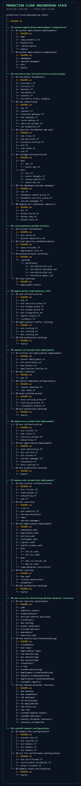

# **Project 1 — Production Cloud Engineering Stack**

**Complete Implementation Roadmap — Organized by Technology and Deployment Environment**

Three production deployment environments:

1. Amazon EC2
2. Amazon ECS
3. Amazon EKS

One Python application, one container image, shared AWS infrastructure, and three independent production deployments.

# **PHASE 1 — Python Application Development & Integration**

## **1.1 Python Application Development**

- Create Python application
- Create application requirements file
- Configure Python application
- Configure application health-check endpoint
- Configure application logging
- Create Dockerfile
- Build Docker image
- Test Docker container locally
- Verify application functionality
- Prepare application configuration for EC2, ECS and EKS deployments

## **1.2 Python Application Integration**

- Configure Python application to retrieve Secrets Manager credentials
- Connect Python application to RDS
- Configure Python application to use EFS
- Configure application access to persistent storage
- Test application database connectivity
- Test Python-to-RDS connection
- Test EFS read/write
- Test application functionality across EC2, ECS and EKS

# **PHASE 2 — Terraform & AWS Infrastructure Provisioning**

## **2.1 Terraform Foundation**

- Install Terraform
- Install AWS CLI
- Configure AWS CLI
- Create Terraform project structure
- Configure Terraform and AWS provider
- Configure Terraform state storage
- Configure Terraform init, validate, plan and apply

## **2.2 VPC & Networking**

- Create VPC
- Create public subnets
- Create private application subnets
- Create private database subnets
- Create Internet Gateway
- Create public route tables
- Associate public subnets with route tables
- Create NAT Gateway
- Create private application route tables
- Associate private application subnets with route tables
- Create database route tables
- Associate private database subnets with route tables
- Create security groups
- Create VPC Endpoints
- Configure VPC Endpoint security groups and policies
- Verify private connectivity

## **2.3 Security Foundation, IAM & EC2**

- Create EC2 IAM role
- Configure EC2 IAM policies
- Create EC2 instance profile
- Create initial EC2 instance
- Configure EC2 User Data
- Install Docker
- Install Python
- Configure Docker service
- Configure AWS Systems Manager (SSM)
- Verify EC2 access through SSM Session Manager
- Configure EC2 security group
- Configure IAM permissions for application access
- Verify initial EC2 configuration

## **2.4 Storage Infrastructure**

**EBS Storage**

- Create additional EBS volume
- Attach EBS volume to EC2
- Format EBS volume
- Create EBS mount directory
- Mount EBS volume
- Configure persistent EBS mounting
- Verify EBS mount

**EFS Shared Storage**

- Create EFS filesystem
- Create EFS mount targets
- Configure EFS security group
- Create EFS access point (if required)
- Configure EFS permissions
- Verify EFS networking
- Verify shared storage access

## **2.5 RDS Database & Secrets Manager**

**RDS Database**

- Create RDS subnet group
- Configure RDS security group rules
- Create RDS instance
- Configure database
- Verify RDS provisioning

**Secrets Manager**

- Create Secrets Manager secret
- Store RDS credentials
- Configure EC2 IAM permissions for Secrets Manager
- Configure Secrets Manager VPC Endpoint
- Verify private Secrets Manager access

## **2.6 Amazon ECR — Container Registry**

- Create ECR repository
- Authenticate Docker to ECR
- Tag Docker image
- Push Docker image to ECR
- Verify ECR image
- Configure ECR access through VPC Endpoints
- Test ECR access through VPC Endpoints

# **PHASE 3 — CI/CD Pipeline & GitHub Actions**

## **3.1 Project Foundation**

- Create project directory
- Create GitHub repository
- Install and configure Git

## **3.2 CI/CD Security & Authentication**

- Create IAM deployment role for CI/CD
- Configure GitHub Actions OIDC authentication

## **3.3 GitHub Actions Workflow**

- Create CI/CD workflow
- Configure automated deployment workflow
- Configure Terraform initialization
- Configure Terraform validation
- Configure Terraform plan
- Configure Terraform apply workflow
- Configure deployment authentication through GitHub Actions OIDC

## **3.4 CI/CD Testing**

- Test CI/CD deployment
- Verify GitHub Actions authentication
- Verify Terraform deployment workflow
- Verify successful infrastructure deployment

# **PHASE 4 — Application Load Balancer (ALB)**

## **4.1 ALB Infrastructure**

- Create ALB
- Configure ALB security group
- Create EC2 Target Group
- Create ECS Target Group
- Configure EKS ingress/load-balancer integration
- Configure Target Group health checks
- Create ALB listeners

## **4.2 Application Traffic Routing**

- Configure routing for EC2 application
- Configure routing for ECS application
- Configure routing for EKS application
- Configure application traffic routing
- Verify ALB configuration
- Verify traffic routing to the correct application environment

## **4.3 ALB Production Testing**

- Test ALB traffic
- Verify EC2 target registration
- Verify ECS target registration
- Verify EKS ingress and ALB traffic
- Verify Target Group health checks
- Verify application availability through ALB

# **PHASE 5 — Amazon EC2 Production Deployment**

## **5.1 Initial EC2 Application Deployment**

- Deploy Python application container to initial EC2
- Configure Docker bind mount for EFS
- Configure application access to additional EBS
- Configure application startup on reboot
- Test application
- Test Python-to-RDS connection
- Test Secrets Manager access
- Test EFS read/write
- Test EBS read/write
- Verify initial EC2 application deployment

## **5.2 AMI Creation**

- Finalize initial EC2 configuration
- Verify application files and Docker configuration
- Verify additional EBS volume inclusion
- Verify EFS boot-time mount configuration
- Create AMI
- Verify AMI and EBS snapshot mappings

## **5.3 Launch Template Configuration**

- Create Launch Template
- Configure AMI
- Configure instance type
- Configure private subnet networking
- Configure EC2 security group
- Configure IAM instance profile
- Configure EBS block device mappings
- Configure Launch Template User Data for EFS mounting
- Configure application startup
- Configure instance monitoring
- Verify Launch Template configuration

## **5.4 Auto Scaling Group**

- Create Auto Scaling Group
- Configure private application subnets
- Attach ALB Target Group
- Configure desired capacity
- Configure minimum capacity
- Configure maximum capacity
- Configure health checks
- Create scaling policies
- Create CloudWatch scaling alarms
- Verify Auto Scaling configuration

## **5.5 EC2 Production Testing**

- Test Auto Scaling manual scale-out
- Verify new EC2 launches from AMI
- Verify Docker and Python on new EC2
- Verify EBS attachment on new EC2
- Verify automatic EFS mount on new EC2
- Verify application startup on new EC2
- Verify ALB target registration and health checks
- Test Auto Scaling under load
- Test scale-in
- Test instance replacement
- Verify application availability

# **PHASE 6 — Amazon ECS Production Deployment**

*Deployment platform: Amazon ECS on AWS Fargate.*

## **6.1 ECS Infrastructure**

- Create ECS cluster
- Configure ECS cluster networking
- Configure ECS task execution IAM role
- Configure ECS task IAM role
- Configure IAM permissions for ECR
- Configure IAM permissions for Secrets Manager
- Configure ECS security groups
- Configure private subnet deployment
- Configure ECS logging with CloudWatch

## **6.2 ECS Application Deployment**

- Create ECS task definition
- Configure Docker image from ECR
- Configure CPU and memory allocation
- Configure container environment variables
- Configure Secrets Manager integration
- Configure RDS connectivity
- Configure EFS volume integration
- Configure EFS mount points
- Configure container logging
- Configure container health checks
- Create ECS service
- Configure desired task count
- Configure minimum and maximum capacity
- Configure ECS service networking
- Configure ECS deployment strategy
- Configure ECS service Auto Scaling
- Configure ECS scaling policies
- Configure ECS CloudWatch alarms

## **6.3 ECS Production Testing**

- Verify ECS task deployment
- Verify ECS service health
- Verify application connectivity to RDS
- Verify EFS read/write
- Verify Secrets Manager access
- Verify ECS scaling and recovery
- Test container replacement
- Test ECS service scaling
- Test ECS deployment and rollback
- Verify ALB target registration
- Verify CloudWatch logs, metrics and alarms

# **PHASE 7 — Amazon EKS Production Deployment**

## **7.1 EKS Cluster Infrastructure**

- Create EKS cluster
- Configure EKS cluster networking
- Configure Kubernetes control plane access
- Configure private application subnets
- Configure EKS managed node groups
- Configure worker node instance types
- Configure worker node IAM roles
- Configure Kubernetes IAM permissions
- Configure EKS security groups
- Configure cluster endpoint access
- Configure EKS access management
- Verify EKS cluster provisioning
- Verify worker node registration

## **7.2 EKS Security**

- Configure IAM Roles for Service Accounts (IRSA) or EKS Pod Identity
- Configure Kubernetes service accounts
- Configure pod-level IAM permissions
- Configure Secrets Manager access
- Configure Kubernetes RBAC
- Configure namespace permissions
- Verify secure application access

## **7.3 EKS Application Deployment**

- Create Kubernetes namespace
- Create Kubernetes Deployment
- Configure Docker image from ECR
- Configure replica count
- Configure container resource requests and limits
- Configure Kubernetes ConfigMaps
- Configure application Secrets Manager integration
- Configure RDS connectivity
- Configure EFS integration
- Configure EFS persistent volumes
- Configure EFS persistent volume claims
- Configure EBS CSI driver
- Configure EBS persistent volumes where required
- Create Kubernetes Service
- Configure application health probes
- Configure readiness probes
- Configure liveness probes
- Configure Kubernetes Ingress
- Configure AWS Load Balancer Controller
- Configure application traffic routing
- Verify application deployment
- Verify pod health
- Verify Python-to-RDS connection
- Verify EFS shared storage
- Verify Secrets Manager access
- Verify application availability

## **7.4 EKS Scaling**

- Configure Horizontal Pod Autoscaler (HPA)
- Configure cluster capacity scaling
- Configure Cluster Autoscaler or Karpenter
- Configure pod resource monitoring
- Configure Kubernetes scaling policies
- Test pod scale-out
- Test pod scale-in
- Test worker node scaling
- Verify application availability during scaling

## **7.5 EKS Production Testing**

- Verify Kubernetes cluster health
- Verify worker node health
- Verify pod deployment
- Test pod replacement
- Test pod scaling
- Test worker node scaling
- Test Kubernetes deployment rollback
- Test RDS connectivity
- Test EFS shared storage
- Test Secrets Manager access
- Verify ingress and ALB traffic
- Verify CloudWatch logs, metrics and alarms

# **PHASE 8 — AWS Security, Monitoring, Troubleshooting, Backup & Disaster Recovery**

This phase follows the three sections in your screenshot:

1. AWS Security and Governance
2. AWS Monitoring and Troubleshooting
3. AWS Backup and Disaster Recovery

## **8.1 AWS Security and Governance**

**You should be able to:**

1. Create and manage IAM policies.
2. Configure IAM Identity Center.
3. Configure AWS Organizations.
4. Create separate production, development and security accounts.
5. Configure Service Control Policies.
6. Configure CloudTrail.
7. Configure AWS Config.
8. Use IAM Access Analyzer.
9. Review AWS Trusted Advisor recommendations.
10. Configure Amazon GuardDuty.
11. Understand AWS Security Hub.
12. Investigate security findings.
13. Apply least-privilege access.
14. Audit AWS account activity.

**Practical task:** Build a secure AWS environment with separate development and production accounts, least-privilege permissions and security monitoring.

## **8.2 AWS Monitoring and Troubleshooting**

**You should be able to:**

1. Configure CloudWatch metrics.
2. Create CloudWatch dashboards.
3. Create CloudWatch alarms.
4. Collect EC2 system logs.
5. Monitor application logs.
6. Monitor RDS performance.
7. Monitor ECS and EKS workloads.
8. Configure CloudTrail auditing.
9. Use AWS X-Ray for application tracing.
10. Monitor CPU, memory and disk usage.
11. Investigate failed deployments.
12. Troubleshoot network connectivity.
13. Investigate application errors.
14. Identify infrastructure performance problems.
15. Generate incident reports.

**Practical task:** Configure CloudWatch to monitor your application, collect application logs, detect high CPU usage and send alerts when something goes wrong.

## **8.3 AWS Backup and Disaster Recovery**

**You should be able to:**

1. Create AWS Backup plans.
2. Configure EBS snapshots.
3. Configure RDS automated backups.
4. Configure RDS snapshot backups.
5. Configure S3 versioning.
6. Configure S3 replication.
7. Configure RDS Multi-AZ.
8. Understand Recovery Point Objectives (RPO).
9. Understand Recovery Time Objectives (RTO).
10. Configure Route 53 health checks.
11. Configure Route 53 failover routing.
12. Understand AWS Elastic Disaster Recovery.
13. Restore resources from backups.
14. Test disaster recovery procedures.
15. Document backup and recovery procedures.

**Practical task:** Simulate an infrastructure failure, restore your database and storage from backups, and verify that the application can recover.

# **PHASE 9 — Route 53 & Domain Configuration**

## **9.1 Domain & DNS Configuration**

- Create Route 53 hosted zone
- Create Route 53 DNS records
- Configure domain routing for EC2
- Configure domain routing for ECS
- Configure domain routing for EKS

## **9.2 SSL/TLS Certificate Configuration**

- Request ACM SSL/TLS certificate
- Validate ACM certificate
- Configure HTTPS listener on ALB
- Configure HTTP-to-HTTPS redirect

## **9.3 Domain & HTTPS Verification**

- Verify domain access
- Verify HTTPS
- Verify SSL/TLS certificate
- Verify Route 53 domain
- Verify domain routing to EC2
- Verify domain routing to ECS
- Verify domain routing to EKS

**Example domain structure:**

- ec2.example.com
- ecs.example.com
- eks.example.com

